# Bare-metal C++ MNIST Classifier

This project is a from-scratch C++17 MNIST digit classifier. It deliberately
avoids the usual machine-learning frameworks. The IDX file parser, neural-network
forward pass, stochastic-gradient-descent (SGD) training loop, mini-batching, backpropagation, evaluation counters,
model serialization helpers, and terminal drawing interface are all implemented
in the project itself.

The application performs the following steps:

1. Load the dataset, network, and training settings from `config.yaml`.
2. Read the MNIST training and test images and labels from the configured
   directory.
3. Validate the IDX headers, magic numbers, image dimensions, and sample counts.
4. Build an index of training samples by true digit.
5. Construct a configured fully connected neural network.
6. Train it for twenty epochs with a learning rate of `0.4`.
   For each epoch, divide the training set into mini-batches of 64 samples.
   For every batch, calculate each sample's forward and backward pass,
   accumulate the gradient contributions, average the accumulated gradients,
   and update the weights and biases once.
7. Classify every test image and print per-digit and overall accuracy.
8. Open an interactive 28 x 28 terminal canvas so a user can draw a digit.
9. Classify each drawing until the user quits.

The result is an executable named `mnist_app`. It is an educational
implementation rather than a production classifier: training is intentionally
simple and uses nested vectors, OpenMP thread-local gradient accumulation, and
a critical reduction rather than an optimized tensor backend. Weights are
initialized with a fixed seed, and predictions are based on sigmoid output
scores. Each image is normalized in a separate preprocessing pass before the
matrix calculations; the normalized values are then reused instead of
dividing by `255.0` inside the weight loops.

## Repository layout

```text
baremetal/
├── scripts/
│   └── download_files.sh
├── data/
│   ├── train-images-idx3-ubyte
│   ├── train-labels-idx1-ubyte
│   ├── t10k-images-idx3-ubyte
│   └── t10k-labels-idx1-ubyte
├── include/
│   ├── canvas.hpp
│   ├── config.hpp
│   ├── mnist_loader.hpp
│   └── neural_network.hpp
├── config.yaml                  # runtime data, network, and training settings
├── Makefile                      # standalone command-line build
├── gitcommit.src                 # timestamped commit and GitHub push helper
├── .gitignore                    # excludes generated files and downloaded data
├── src/
│   ├── canvas.cpp
│   ├── config.cpp
│   ├── main.cpp
│   ├── mnist_loader.cpp
│   └── neural_network.cpp
├── build/                        # compiler-generated object files
├── mnist_app                     # compiler-generated executable
└── .vscode/                      # build, debug, and IntelliSense settings
```

### `gitcommit.src`

This script initializes the local repository when necessary, verifies or adds
the expected `origin`, stages non-ignored project files, creates a timestamped
or user-supplied commit, and pushes the `main` branch. It does not replace
GitHub authentication; the local Git credential manager, SSH setup, or token
workflow must already be configured.

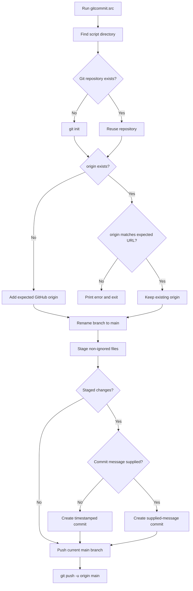

The program expects to be launched from the project root because `main.cpp`
loads `config.yaml` and uses the paths configured there.

## GitHub workflow

The repository includes [`gitcommit.src`](./gitcommit.src), a standalone Bash
helper for committing the current project and pushing the `main` branch to
GitHub. It uses the repository URL from the command-line setup documented by
GitHub:

```text
https://github.com/jirahandler/baremetal-mnist-cpp-ml.git
```

Make the helper executable once, then run it from the project root:

```bash
chmod +x gitcommit.src
./gitcommit.src
```

With no argument, it creates a commit message containing the local date, time,
and time-zone offset:

```text
Update project - 2026-10-12 02:00:00 +0530
```

For a descriptive message, pass one argument:

```bash
./gitcommit.src "Document Makefile and platform setup"
```

On its first run, the helper initializes Git if needed, adds the configured
`origin`, renames the current branch to `main`, stages all non-ignored files,
creates a commit when there are staged changes, and runs:

```bash
git push -u origin main
```

On later runs, it reuses the existing `origin` and pushes the updated `main`
branch. It stops instead of changing an existing `origin` that points to a
different URL. GitHub authentication is still required; use the normal Git
credential manager, SSH configuration, or a GitHub-supported token workflow.

The accompanying [`.gitignore`](./.gitignore) excludes compiler output,
debug-symbol directories, assembly inspection files, macOS metadata, and the
downloaded MNIST data. The data files are intentionally not committed because
they are large generated downloads; run
[`scripts/download_files.sh`](./scripts/download_files.sh) after cloning.

## Project setup order

Create [`scripts/download_files.sh`](./scripts/download_files.sh) first when
recreating this project from an empty directory. It is the bootstrap file for
the dataset: the remaining application files depend on the MNIST IDX files
that it downloads into `data/`. After creating it, make it executable and run
it before compiling the C++ sources:

```bash
chmod +x scripts/download_files.sh
./scripts/download_files.sh
```

The script accepts an optional destination directory:

```bash
./scripts/download_files.sh /tmp/mnist
```

If a custom directory is used, update the `data.dir` value in
[`config.yaml`](./config.yaml), or copy the verified files into the project's
configured data directory before running the application.

## Dependencies

The project requires Homebrew GCC 16, OpenMP, and yaml-cpp. Install yaml-cpp
from source with the same GCC toolchain used by the project:

```bash
HOMEBREW_CC=gcc-16 \
HOMEBREW_CXX=g++-16 \
brew install --build-from-source yaml-cpp
```

The build expects yaml-cpp headers under `/opt/homebrew/include` and the
library under `/opt/homebrew/lib`. The Makefile links it with `-lyaml-cpp`.
On Intel macOS systems, adjust the Homebrew include, library, compiler, and
debugger paths for the local installation.

## Build and run

### VS Code

Use the default build task, **Build with Homebrew GCC**, or start the
**Debug with Homebrew GDB** launch configuration. These configurations expect:

- Homebrew GCC at `/opt/homebrew/bin/g++-16`
- Homebrew GDB at `/opt/homebrew/bin/gdb` for debugging
- C++17 support

### Command line

The project also includes a standalone [Makefile](./Makefile) for command-line
builds. From the project root, after the dataset has been downloaded:

```bash
make
make run
```

`make` is the recommended legacy command-line workflow. The first command
builds `mnist_app`; `make run` builds it if necessary and then starts it.

The Makefile uses `/opt/homebrew/bin/g++-16` by default and matches the
toolchain settings used by the VS Code build task. It includes the Homebrew
header and library paths and links against yaml-cpp:

- C++17
- `-O3`
- `-ffast-math`
- `-march=native`
- `-fopenmp`
- debug symbols with `-g`
- `/opt/homebrew/include` and `/opt/homebrew/lib`
- `-lyaml-cpp`

Useful targets are:

```bash
make             # compile and link mnist_app
make run         # build if needed, then run the application
make download    # run scripts/download_files.sh
make clean       # remove build/, mnist_app, and mnist_app.dSYM
```

To use another compiler without editing the Makefile, override `CXX`:

```bash
make CXX=/path/to/g++
```

The Makefile creates dependency files beside the object files, rebuilds only
changed translation units, and links all `src/*.cpp` files into `mnist_app`.
It is independent of the VS Code tasks and does not modify `.vscode/`.

The training loop uses one OpenMP parallel region around the epoch and
mini-batch loops. The region is hoisted outside those loops so the worker team
and its buffers are created once and reused across the run. `#pragma omp
parallel` gives each worker private activation, error, and gradient buffers;
`#pragma omp for` distributes samples across the workers; and
`#pragma omp critical` serializes only the reduction of each private gradient
into the shared batch accumulator. After an explicit barrier, one thread
performs the parameter update with `#pragma omp single`; the following
implicit barrier prevents other threads from starting the next batch until the
update is complete. No thread writes weights while another thread is reading
them.
The `-fopenmp` option remains required in the Makefile and VS Code build flags.

### Running on Macbook Air M4

The checked-in defaults target an Apple Silicon Mac with Homebrew installed:

1. Install Homebrew GCC and GDB if they are not already available.
2. Install yaml-cpp with the source-build command in the
   [Dependencies](#dependencies) section.
3. Confirm that `/opt/homebrew/bin/g++-16`, `/opt/homebrew/bin/gdb`, and the
   yaml-cpp headers and library exist.
4. Run `make` and then `make run`, or use the VS Code build and debug
   configurations.

The Makefile is independent of VS Code and uses the compiler specified by its
`CXX` setting. The VS Code files contain their own absolute compiler and
debugger paths, so changing the Makefile alone does not change VS Code.

### Running on another system

The source requires a C++17 compiler and a POSIX terminal for the interactive
canvas. To use the Makefile with another compiler, override `CXX` on the
command line:

```bash
make CXX=/usr/bin/g++ clean
make CXX=/usr/bin/g++ run
```

Adjust the path for the target system, for example `/usr/bin/clang++` or a
Homebrew installation under `/usr/local/bin`. The compiler must support the
flags in the Makefile, particularly `-fopenmp`; if it does not, remove or
adapt the OpenMP flag in a local Makefile copy and provide a serial fallback.
OpenMP is required by the current parallel training loop.

For VS Code on another system, update the absolute paths consistently in:

- `.vscode/tasks.json`: the build task's `command`
- `.vscode/c_cpp_properties.json`: `compilerPath`
- `.vscode/settings.json`: the `clangd` `--query-driver` path
- `.vscode/launch.json`: `miDebuggerPath`

Also update the debugger type or `MIMode` if the system uses LLDB instead of
GDB. For example, a Linux setup might use `/usr/bin/g++` and
`/usr/bin/gdb`; a macOS setup using Clang may use `/usr/bin/clang++` and
`/usr/bin/lldb`. The exact debugger configuration depends on the VS Code C++
extension and debugger installed on that system.

The executable must be run in a terminal that supports ANSI escape sequences
and raw keyboard input. The canvas uses arrow keys, Space, `c`, Enter, and `q`.

## Current implementation changes

The current code separates dataset preparation, image normalization, model
calculation, and interactive-image preparation:

1. [`config.yaml`](./config.yaml) supplies the runtime data, network, and
   training settings.
2. [`scripts/download_files.sh`](./scripts/download_files.sh) is created first
   during a fresh setup. It downloads, decompresses, and verifies the four
   MNIST IDX files.
3. [`src/mnist_loader.cpp`](./src/mnist_loader.cpp) loads image bytes and
   labels, validates the IDX headers, and builds the ordered `by_label` index.
4. [`src/main.cpp`](./src/main.cpp) loads `config.yaml` and creates `train_norm`
   before training.
   Each training pixel is divided by `255.0` once and stored as a
   `double`. The already-normalized vectors are passed to `NeuralNetwork::train`.
4. [`src/neural_network.cpp`](./src/neural_network.cpp) receives those
   normalized training vectors by const reference, so the training matrix
   loops do not repeat the pixel division.
5. For test images and hand-drawn images, `forward()` still receives
   byte-valued pixels and calls the file-local `normalize_input()` helper.
   That helper uses `std::transform` to divide each pixel by `255.0` in one
   preprocessing pass before the weight loops.
6. Before a hand-drawn image is classified, `main.cpp` calls
   `preprocess_canvas()`. It finds the non-zero bounding box, scales the
   drawing so its longest side is 20 pixels, centers it in a 28 x 28 output
   image, and uses nearest-neighbor sampling.
7. The network records per-true-digit statistics, supports binary
   `save()`/`load()`, and uses explicit `static_cast` conversions where an
   API or arithmetic operation requires a specific numeric type.

This gives the project two input paths with the same model-space result:

- Training data is normalized in `main.cpp` before `train()`.
- Test and canvas data are normalized inside `forward()` before inference.

In both paths, the matrix operations consume floating-point values in the
approximate range `[0.0, 1.0]`.

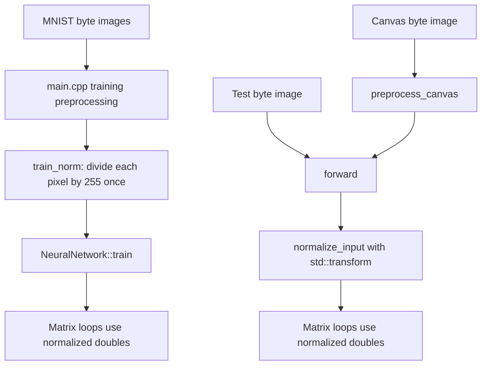

## System-level data flow

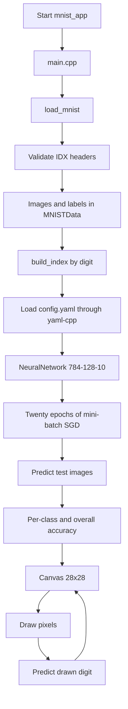

## File-by-file details

### `config.yaml`

`config.yaml` is loaded at startup by [`src/main.cpp`](./src/main.cpp) through
yaml-cpp. It defines the dataset paths and filenames, network dimensions and
initialization parameters, and training parameters:

```yaml
data:
  dir: "data"
  train_images: "train-images-idx3-ubyte"
  train_labels: "train-labels-idx1-ubyte"
  test_images: "t10k-images-idx3-ubyte"
  test_labels: "t10k-labels-idx1-ubyte"

network:
  input_size: 784
  hidden_size: 128
  output_size: 10
  seed: 42
  weight_init_range: 0.1

training:
  epochs: 20
  learning_rate: 0.4
  batch_size: 64
```

Keep the configured data directory and filenames aligned with the files
downloaded by [`scripts/download_files.sh`](./scripts/download_files.sh).

### `include/config.hpp`

Declares the `Config` structure and `load_config()` function. The structure
contains the `data`, `network`, and `training` sections read from
`config.yaml`.

### `src/config.cpp`

Implements configuration loading with yaml-cpp. YAML parsing failures are
reported as `std::runtime_error`; missing or incorrectly typed configuration
values are rejected by yaml-cpp's typed accessors.

### `src/main.cpp`

`main.cpp` is the application orchestrator. It chooses the data directory,
loads the training and test sets, prints the training distribution, trains the
network, evaluates the test set, and starts the interactive drawing loop.

Important behavior:

- Training uses the `epochs`, `learning_rate`, and `batch_size` values from
  `config.yaml` (the checked-in defaults are `20`, `0.4`, and `64`).
- The network dimensions are `784` input values, `128` hidden units, and
  `10` output units.
- Training images are copied into `train_norm` and normalized in `main.cpp`
  before `net.train()` is called. `train()` therefore receives
  `std::vector<std::vector<double>>` values that are already in approximately
  the `[0.0, 1.0]` range.
- The training normalization loop is intentionally outside the neural-network
  matrix loops. It is a clear replacement point for later vectorized code.
- Each test label is recorded against its prediction, so `stats()[digit]`
  represents recall for images whose true class is `digit`.
- Manual drawings are inspected, cropped to their non-zero bounding box,
  resized to fit a 20-pixel longest side, centered in a 28 x 28 image, and
  then classified.
- A debug line reports the number of set canvas pixels and the detected
  bounding box before the drawing is classified.
- The interactive canvas is always entered after evaluation.
- Pressing `q` while drawing exits immediately; pressing `q` at the post-result
  prompt exits the drawing loop normally.
- No exception handling is installed in `main`; file and validation failures
  terminate the program with the thrown error.

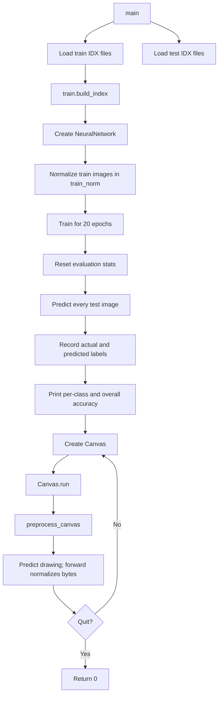

`preprocess_canvas()` is a separate input-preparation step for the interactive
path. It preserves an empty canvas as empty, finds the occupied-pixel bounds,
scales the longest occupied dimension to 20 pixels, creates a zero-filled
28 x 28 output image, and copies source pixels into the centered output using
nearest-neighbor sampling. The resulting byte image then follows the same
`forward()` normalization path as a test image.

### `src/mnist_loader.cpp`

This file implements the MNIST IDX parser and the training-label index.

- `reverse_int` converts each 32-bit big-endian IDX header field to the
  host's integer representation.
- `MNISTData::build_index` clears and rebuilds `by_label`, reserving an
  approximate number of entries for each of the ten digits.
- `load_mnist` reads image headers with magic `2051`, requires 28 x 28 images,
  reads `num` grayscale images, then reads a label file with magic `2049`.
- The image and label counts must match.
- Images are stored as `std::vector<uint8_t>` values containing 784 bytes.
- The loader throws `std::runtime_error` when files cannot be opened or
  headers are incompatible.

The loader assumes standard MNIST files and does not perform a final
`read()`-success check for every payload byte. Truncated files may therefore
need additional validation if this is used outside the provided dataset.

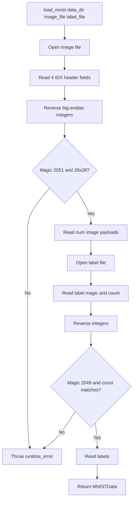

### `include/mnist_loader.hpp`

This header declares the public MNIST data model and loader API.

- `Image` aliases a byte vector for one image.
- `MNISTData::images` stores all images.
- `MNISTData::labels` stores one digit label per image.
- `MNISTData::by_label` maps a digit to image indices after
  `build_index()` is called.
- `load_mnist` accepts a directory and separate image/label filenames.

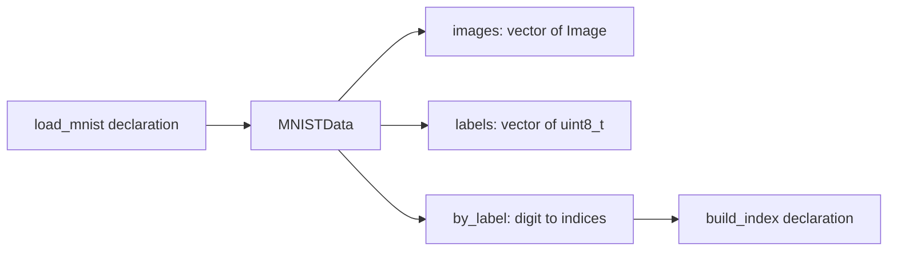

### `src/neural_network.cpp`

This file implements the classifier and its evaluation and persistence
helpers.

#### Model structure

The model has two affine layers with sigmoid activations:

```text
784-byte inference image
        │
        ▼
normalize_input(): divide each pixel by 255.0 once
        │
        ▼
normalized 784-value image
        │
        ▼
W1 (128 x 784) + b1 (128) -> sigmoid -> 128 hidden activations
        │
        ▼
W2 (10 x 128) + b2 (10)  -> sigmoid -> 10 output scores
        │
        ▼
argmax -> predicted digit 0..9
```

#### Training

`train` creates one-hot target vectors and processes samples in mini-batches
of 64.
Before `train` is called, `main.cpp` allocates `train_norm` and uses one
preprocessing loop to divide every training pixel by `255.0`. `train` receives
these `std::vector<double>` images and binds each sample to a const reference,
so the training matrix loops use the prepared values without repeating the
division. This is the current seam for replacing the preprocessing loop with
a SIMD/vectorized implementation.

Inference follows a separate path because test and canvas images remain
byte-valued at their call sites. `forward()` calls the file-local
`normalize_input` helper, which allocates a floating-point vector and uses
`std::transform` to divide each pixel by `255.0` once before the matrix loops.

Training then computes a forward pass, output error, and hidden-layer error for
each sample in the current mini-batch. `#pragma omp parallel` gives each
worker its own activation, error, and gradient buffers. `#pragma omp for
schedule(static)` divides the samples among the workers. Since each worker
accumulates only into its own buffers, the forward and backward calculations
do not race.

After the sample loop, one thread uses `#pragma omp single` to clear the
shared batch accumulators. Its implicit barrier ensures that clearing is
complete before the merge. Then `#pragma omp critical` protects the reduction
from each thread-local gradient into the shared batch accumulator. The critical
section is limited to this merge; the expensive per-sample calculations remain
parallel. An explicit `#pragma omp barrier` follows because `critical` does
not provide a barrier. This prevents the first thread to finish merging from
updating the weights before other threads have contributed.

Finally, one thread uses another `#pragma omp single` to average the batch
gradients and update the weights and biases once. The implicit barrier at the
end of that block keeps all threads aligned before the next batch. No
parameters are modified while worker threads are reading them. This is a
simple mini-batch stochastic-gradient-descent implementation without sample
shuffling, momentum, or a separate loss report.

For one training sample, the complete calculation can be summarized as:

```text
x = train_norm[s]                         <- already in [0, 1]; no division
hidden = sigmoid(W1 * x + b1)             <- forward through layer 1
output = sigmoid(W2 * hidden + b2)        <- forward through layer 2
d_output = (output - target) * sigmoid_deriv(output)
d_hidden = (W2^T * d_output) * sigmoid_deriv(hidden)
accumulate d_output outer hidden into grad_W2
accumulate d_output into grad_b2
accumulate d_hidden outer x into grad_W1
accumulate d_hidden into grad_b1
after every batch:
    scale = learning_rate / current_batch_size
    W2 -= scale * grad_W2
    b2 -= scale * grad_b2
    W1 -= scale * grad_W1
    b1 -= scale * grad_b1
```

Here, `s` identifies the current training sample. The multiplication symbols
represent the corresponding nested loops in the implementation. `W2^T` means
the transpose of `W2`, so each hidden-unit error receives the weighted
contribution from every output-unit error. The two `outer` operations produce
the matrix-shaped updates: every output error is multiplied by every hidden
activation for `W2`, and every hidden error is multiplied by every normalized
input value for `W1`. `target` is the one-hot vector created from the true
label. The code uses element-by-element multiplication where the outline
shows the multiplication of each vector by its sigmoid derivative.

Initialization uses `std::mt19937` with seed `42` and a uniform distribution
from `-0.1` to `0.1`.

#### Evaluation and persistence

- `predict` returns the index of the largest output score.
- `reset_stats`, `record`, and `stats` maintain per-true-class counts.
- `save` writes dimensions, weights, and biases in a simple binary format.
- `load` reconstructs the vectors and reads the same format.
- `main.cpp` currently does not call `save` or `load`; these APIs are
  available for future model reuse.

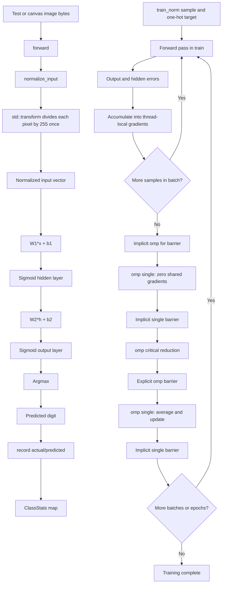

### `include/neural_network.hpp`

This header defines the `ClassStats` value type and the `NeuralNetwork`
interface.

- `ClassStats::accuracy()` safely returns `0.0` when no samples have been
  recorded.
- The constructor accepts layer sizes, allowing the implementation to be
  reused with other dimensions.
- `forward` exposes output scores.
- `train` performs sigmoid mini-batch SGD on images already normalized to
  `double` values by the caller.
- OpenMP parallelizes sample forward/backward work within each batch using
  thread-local workspaces and gradient accumulators, then reduces those
  accumulators before the batch update.
- `predict` performs classification.
- The statistics API exposes true-class recall-style counters.
- `save` and `load` define the binary model persistence interface.

The implementation uses vectors for numbered layers and a map for the ten
display-ordered class counters. This is appropriate for the small fixed
number of classes and keeps iteration order deterministic.

The header also documents the explicit type conversions used at API
boundaries and in accuracy calculations. `static_cast` makes a permitted
numeric conversion explicit: counters are converted to `double` before
division, the output-vector position is converted to the `int` returned by
`predict()`, and a predicted `int` is converted to `uint8_t` before it is
passed to `record()`.

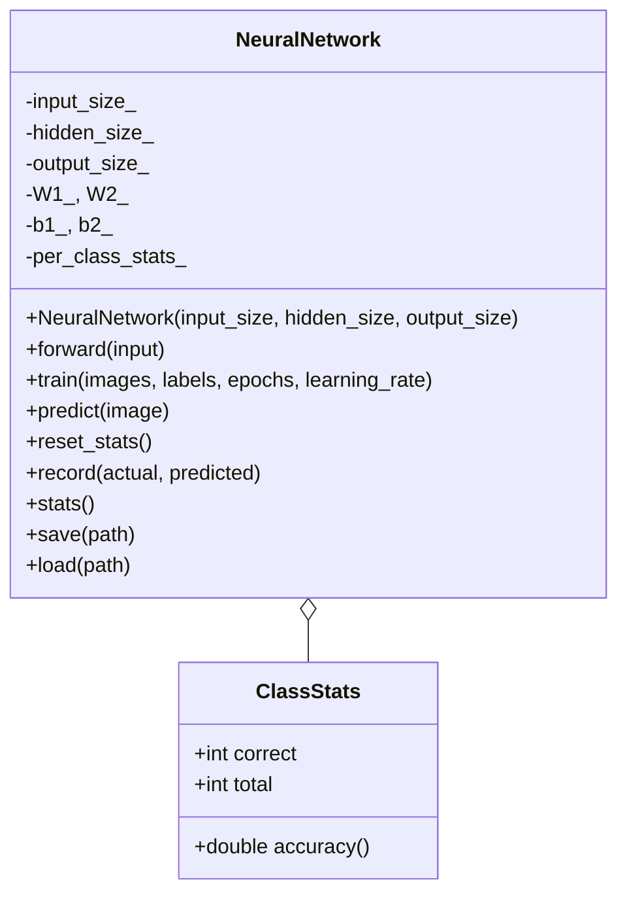

### `src/canvas.cpp`

This file implements the terminal drawing UI used for manual inference.

- Enables POSIX raw mode so keystrokes are received immediately.
- Saves and restores the terminal's original `termios` settings.
- Renders a 28 x 28 grid with ANSI clear-screen, cursor, and reverse-video
  escape sequences.
- Uses `##` for active pixels and two spaces for inactive pixels.
- Decodes arrow-key escape sequences to move the cursor.
- Space toggles the current pixel between `0` and `255`.
- `c` clears the image.
- Enter returns the pixel vector to `main`.
- `q` restores terminal mode and exits the process.

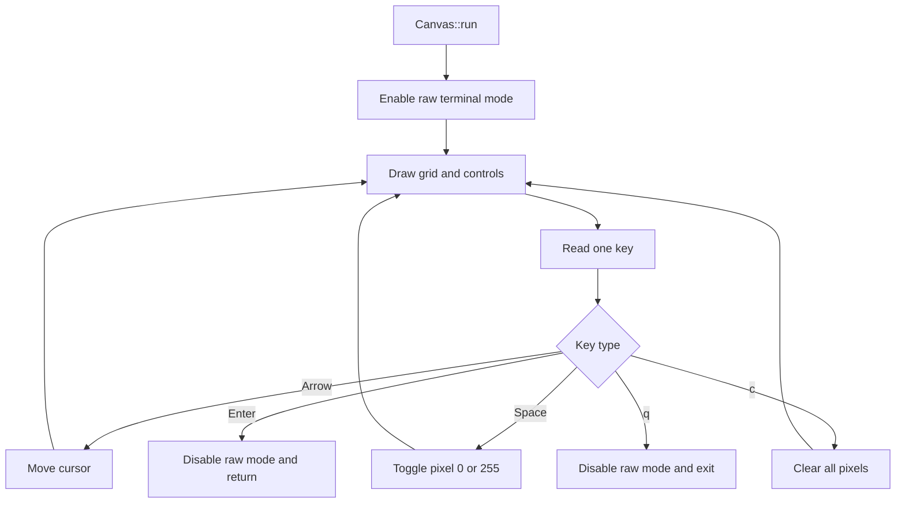

### `include/canvas.hpp`

This header exposes the minimal canvas interface:

- `Canvas(width, height)` creates a zero-filled pixel grid.
- `run()` owns the interactive editing session.
- `pixels()` returns the current image by const reference.

The private state stores dimensions, pixel bytes, and cursor coordinates.

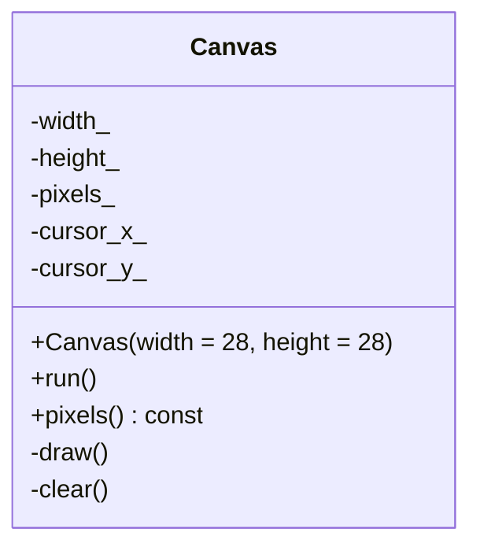

## Data files

The four files in `data/` are binary MNIST IDX files. They are not source code
and should not be edited as text.

### `scripts/download_files.sh`

This Bash script prepares the MNIST dataset required by the application. It
should be the **first project file created** when setting up the project from
scratch, before the C++ headers, source files, or VS Code configuration. It
creates the `data/` directory, downloads the four compressed MNIST files from
the configured Google Cloud Storage mirror, decompresses them, and verifies
each resulting IDX file.

For every file, the script:

1. Downloads the `.gz` file with `curl`.
2. Follows redirects and retries transient network failures.
3. Decompresses the archive with `gunzip`.
4. Checks the exact expected byte size.
5. Reads the first four bytes and checks the IDX magic number.
6. Stops with a non-zero exit status on the first failure.

The size check detects incomplete or unexpected payloads. The magic-number
check detects an incorrect file type, such as an HTML error page, and confirms
whether the file is an image file (`2051`) or label file (`2049`). The script
supports both BSD/macOS and GNU/Linux forms of `stat`.

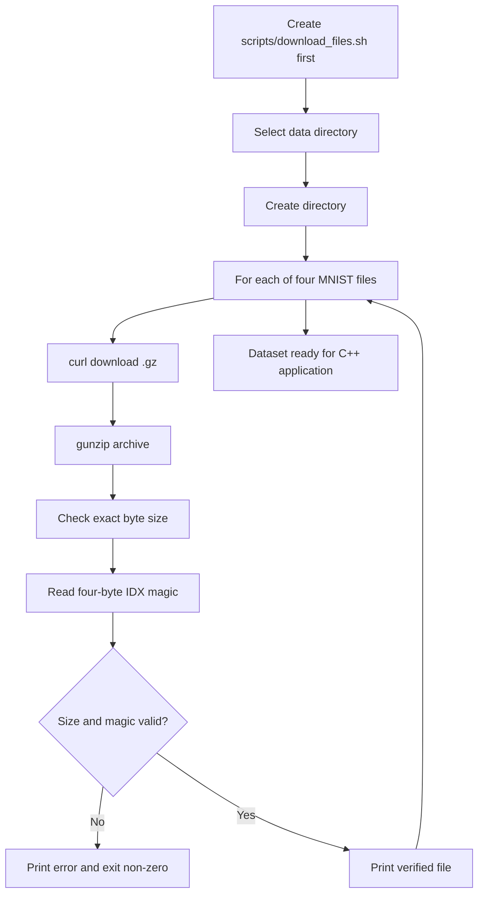

The script does not compile the application or train the neural network. Its
successful outcome is a verified set of four uncompressed files in `data/`,
ready for `src/mnist_loader.cpp` and `src/main.cpp`.

### `data/train-images-idx3-ubyte`

Contains the training image tensor. Its IDX3 header is:

```text
magic number: 2051
image count:  60000
rows:         28
columns:      28
```

Every image contributes 784 grayscale bytes.


### `data/train-labels-idx1-ubyte`

Contains the training labels. Its IDX1 header identifies magic `2049` and
`60000` labels, followed by one byte in the range `0..9` per training image.


### `data/t10k-images-idx3-ubyte`

Contains the test image tensor. It uses the same IDX3 layout as the training
images, with the standard MNIST test count of `10000`.

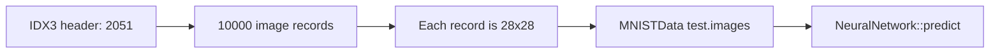

### `data/t10k-labels-idx1-ubyte`

Contains the test labels. It uses IDX1 magic `2049`, contains `10000` labels,
and is paired positionally with `t10k-images-idx3-ubyte`.


## Build and editor files

### `Makefile`

The Makefile is a standalone command-line build path for users who prefer
traditional `make` workflows. It discovers all `.cpp` files under `src/`,
compiles each source file into `build/*.o`, records header dependencies in
`build/*.d`, and links the objects into `mnist_app`.

Its default compiler is Homebrew GCC at `/opt/homebrew/bin/g++-16`, matching
the configured VS Code toolchain. It enables C++17, optimization, fast
floating-point math, native CPU instructions, OpenMP support, and debug
symbols. It adds `/opt/homebrew/include` and `/opt/homebrew/lib` and links
yaml-cpp with `-lyaml-cpp`. The training batch loop uses thread-local
accumulators and a critical reduction to avoid races while retaining parallel
forward/backward computation.

The Makefile does not replace or modify the VS Code tasks. It provides a
separate interface:

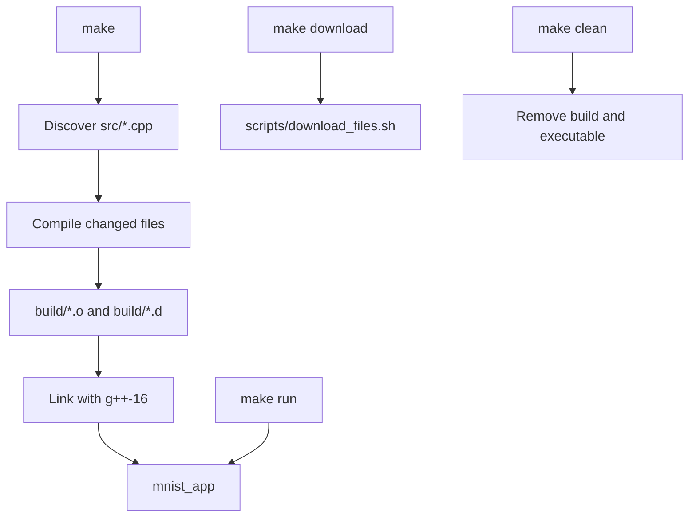

## VS Code files

### `.vscode/tasks.json`

Defines the default build task. It invokes Homebrew GCC with C++17, debug
symbols, optimization, native CPU instructions, OpenMP support, the `include`
search path, the Homebrew include and library paths, yaml-cpp, all `src/*.cpp`
files, and the output path `mnist_app`. The `$gcc` problem matcher turns
compiler diagnostics into editor diagnostics. The separate Makefile uses the
same compiler flags but does not depend on VS Code.

The **Download MNIST** task should invoke
[`scripts/download_files.sh`](./scripts/download_files.sh). The Makefile's
`make download` target or the script itself can also be used directly.

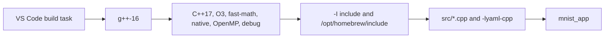

### `.vscode/launch.json`

Defines the debug launch configuration. It builds first, launches `mnist_app`
from the project root, uses GDB through the MI interface, and enables GDB
pretty-printing when available.

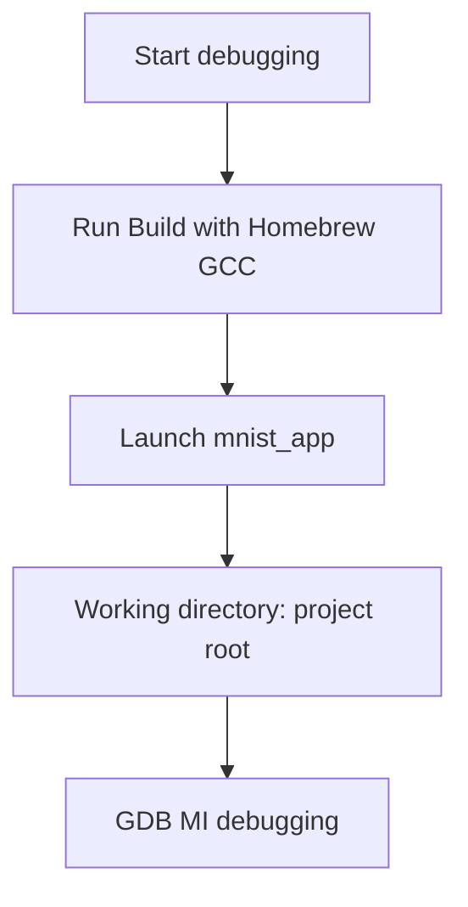

### `.vscode/c_cpp_properties.json`

Configures the Microsoft C/C++ extension to use Apple Clang for system-header
IntelliSense on Apple Silicon, while retaining the Homebrew include path for
yaml-cpp. The actual build continues to use Homebrew GCC through the Makefile
and VS Code task.

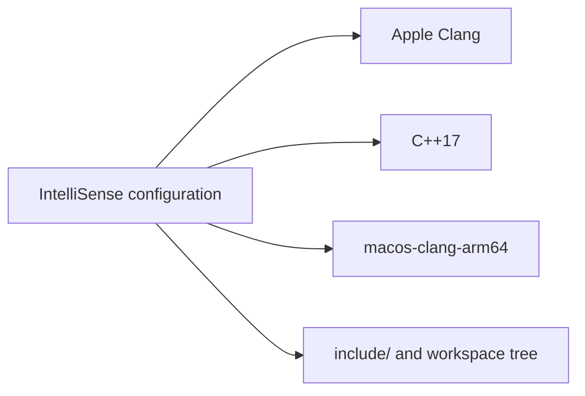

### `.vscode/settings.json`

Enables clangd with the project-level flags in [`.clangd`](./.clangd) and
enables Makefile configuration on workspace open. clangd uses Apple Clang for
macOS system headers; the build task and Makefile continue to use Homebrew
GCC.

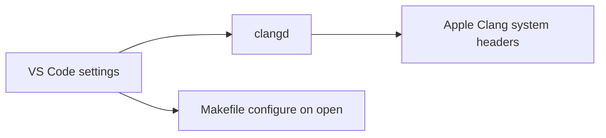

### `.clangd`

The project-level clangd configuration uses Apple Clang for macOS system
headers and adds both the project headers and Homebrew's yaml-cpp headers.
Homebrew GCC remains the compiler used by the build task and Makefile.

```mermaid
flowchart LR
    A[clangd starts] --> B[Read .clangd]
    B --> C[Apple Clang and project flags]
    C --> D[Resolve macOS and yaml-cpp headers]
```

## Generated artifacts

These files are outputs of compilation or debugging rather than inputs to the
application.

### `build/*.o`

The object files (`main.o`, `canvas.o`, `config.o`, `mnist_loader.o`, and
`neural_network.o`) are compiled translation units. They are intermediate
artifacts and are not executed directly.

```mermaid
flowchart LR
    A[src/*.cpp] --> B[g++ compilation]
    C[include/*.hpp] --> B
    B --> D[build/*.o]
    D --> E[Linker]
    E --> F[mnist_app]
```

### `mnist_app`

This is the linked executable produced by the VS Code build task or the command
line build. It combines the object files for all five source files and starts
at `main()`.

```mermaid
flowchart TD
    A[main.o] --> F[Link]
    B[canvas.o] --> F
    C[config.o] --> F
    D[mnist_loader.o] --> F
    E[neural_network.o] --> F
    F --> G[mnist_app]
    G --> H[Load config, train, evaluate, draw]
```

### `mnist_app.dSYM/Contents/Info.plist`

This macOS debug-symbol bundle metadata identifies the generated debug
artifact. It supports debugger tooling and has no role in model inference.

```mermaid
flowchart LR
    A[Build with -g] --> B[macOS debug-symbol generation]
    B --> C[Info.plist metadata]
    C --> D[Debugger locates symbols]
```

### `mnist_app.dSYM/Contents/Resources/DWARF/mnist_app`

This DWARF file contains the executable's debug information, including source
locations and symbols used by GDB or compatible debugger tooling.

```mermaid
flowchart LR
    A[mnist_app compiled with -g] --> B[DWARF symbol generation]
    B --> C[DWARF/mnist_app]
    C --> D[Source-level debugging]
```

### `mnist_app.dSYM/Contents/Resources/Relocations/aarch64/mnist_app.yml`

This relocation metadata helps macOS debugger tooling map symbols for the
Apple Silicon (`aarch64`) target.

```mermaid
flowchart LR
    A[Apple Silicon executable] --> B[Relocation information]
    B --> C[mnist_app.yml]
    C --> D[Debugger address mapping]
```

## Expected output and outcome

On a successful run, the program should first print messages similar to:

```text
Loading MNIST data...
Training set size: 60000
  digit 0: ... samples
  ...
  digit 9: ... samples

Training network (this may take a minute)...
Training done in ... seconds.

Per-class accuracy on the test set:
  digit 0: .../...  (...%)
  ...
  digit 9: .../...  (...%)
  overall:  .../...  (...%)
```

The exact accuracy and training time depend on compiler, CPU, thread count, and
runtime conditions. Initialization is seeded with `42`, but thread-local
gradient reductions may occur in different orders. Floating-point rounding,
thread scheduling, and toolchain differences can therefore affect final
values slightly; bit-for-bit repeatability is not guaranteed.

After evaluation, an empty 28 x 28 canvas appears. Draw a rough digit with the
keyboard and press Enter. The application prints:

```text
>>> The network predicts: 7 <<<
```

The expected functional outcome is a trained in-memory classifier that reports
test-set performance and classifies manually drawn 28 x 28 binary images. The
application does not currently write a trained model to disk, so every launch
starts from the same seed-controlled initial weights and trains a new model.

## Known constraints

- Training is CPU-only and uses nested `std::vector` containers, so it is
  intentionally slower than optimized tensor implementations.
- Mini-batches are fixed at 64 samples. Sample forward/backward work is
  distributed with OpenMP, while gradient reduction and parameter updates are
  synchronized. There is no sample shuffling, validation split, early
  stopping, momentum, or regularization.
- OpenMP parallelism is limited to samples within a batch. The implementation
  uses thread-local workspaces and accumulators, then merges them through a
  critical section; it does not run multiple parameter-update batches
  concurrently.
- Because thread-local gradients can be merged in different orders,
  floating-point rounding may vary slightly between runs or thread counts.
  The fixed random seed still fixes initialization, but parallel reduction
  does not guarantee bit-for-bit identical training results.
- The output layer uses independent sigmoid activations rather than softmax.
- Training expects normalized `std::vector<double>` inputs prepared by
  `main.cpp`; test and canvas inference accepts byte-valued images and
  normalizes them inside `forward()`.
- `forward` and `predict` assume an input with at least 784 pixels; they do not
  validate shorter inputs before indexing them.
- The interactive UI requires a POSIX terminal (`termios`, `unistd.h`) and
  ANSI escape-sequence support.
- The checked-in VS Code build and debug configurations target macOS/Homebrew,
  while the standalone Makefile supports compiler overrides through `CXX`.
- Model `save`/`load` exists, but `main.cpp` does not expose a command-line
  option for loading a model or saving the trained model. Each launch starts
  from the same seed-controlled initial weights, then trains a new model.
- `main.cpp` loads the relative `config.yaml` file at startup. The dataset
  directory and filenames can be changed there without modifying the source.
- The loader validates the IDX headers, dimensions, and image/label counts, but
  does not perform a final successful-read check for every payload byte.
